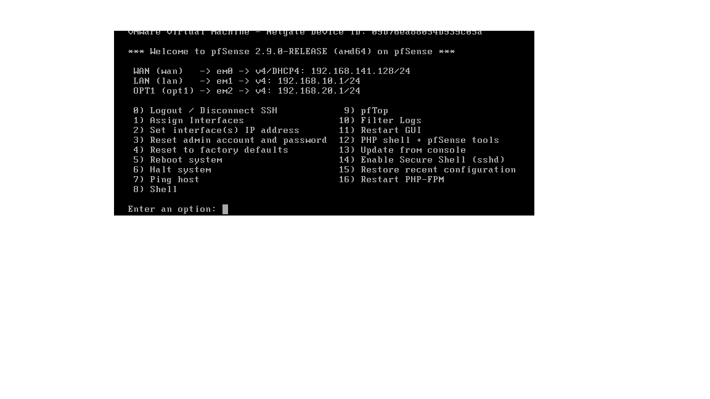
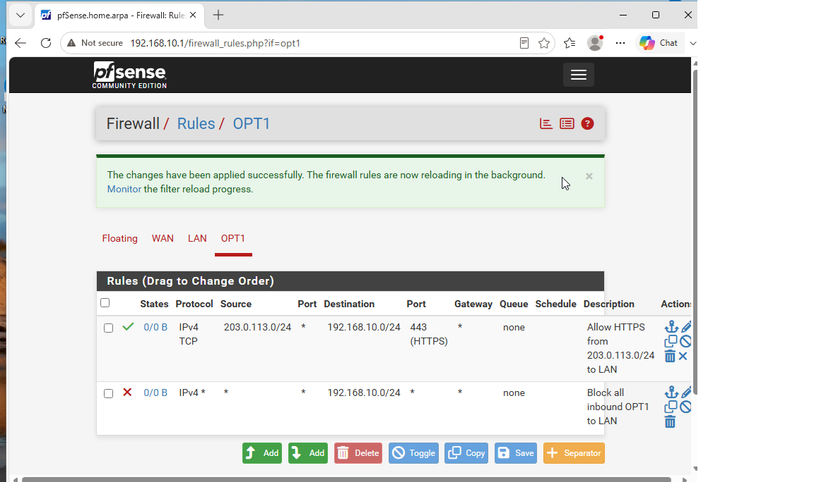
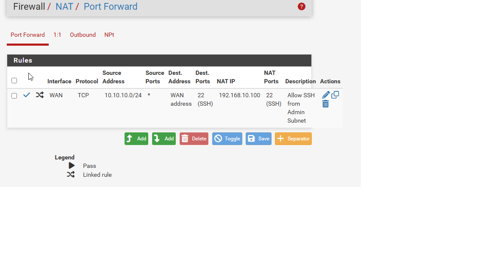

# Firewall, VPN & Network Segmentation

## Project Overview

Implemented network security controls across virtualized lab environments to protect internal networks, secure remote access, and restrict unauthorized communication between network segments.

The project combined firewall configuration, VPN implementation, multifactor authentication, and VLAN-based network segmentation.

## Technologies Used

- VMware Workstation
- pfSense Firewall
- OpenVPN
- IPsec / IKEv2
- FreeRADIUS
- Google Authenticator
- Cisco Packet Tracer
- Wireshark
- Kali Linux
- Ubuntu Linux

## Project Implementation

### Phase A: Firewall Configuration
- Configured pfSense LAN, WAN, and DMZ interfaces.
- Implemented firewall rules restricting traffic between network segments.
- Configured NAT and tested permitted and blocked connections.
- Used packet captures to validate firewall behavior.

### Phase B: VPN Security
- Configured OpenVPN for secure remote access.
- Implemented an IPsec IKEv2 VPN using strong encryption.
- Verified encrypted VPN traffic using Wireshark.

### Phase C: Multifactor Authentication
- Integrated FreeRADIUS with Google Authenticator.
- Configured time-based one-time password authentication.
- Tested MFA authentication during VPN access.

### Phase D: VLAN Segmentation
- Created Finance, HR, IT, and Guest VLANs in Cisco Packet Tracer.
- Configured router-on-a-stick inter-VLAN routing.
- Implemented ACLs to restrict communication between departments.
- Tested guest network isolation.

## Skills Demonstrated

- Firewall administration
- Network segmentation
- VPN configuration and troubleshooting
- IPsec and encryption
- Multifactor authentication
- Cisco VLANs and ACLs
- Network traffic analysis

## Project Evidence

### pfSense Firewall Setup

### Firewall Security Rules

### NAT Configuration

Configuration screenshots, VPN traffic captures, firewall rules, and VLAN diagrams will be added here.

## Key Takeaways

This project strengthened my understanding of defense-in-depth security by combining firewall policies, secure remote access, multifactor authentication, and network segmentation.

All configurations and security testing were performed in authorized lab environments.
