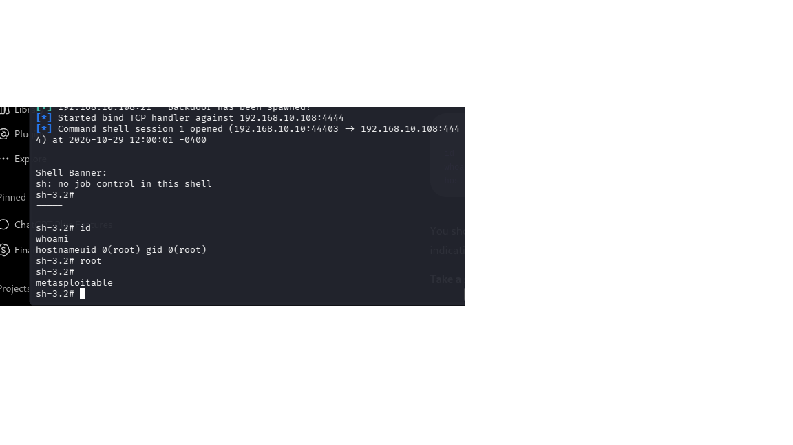

# Vulnerability Assessment & Penetration Testing

## Project Overview

Conducted an authorized vulnerability assessment and controlled penetration test against Metasploitable2, an intentionally vulnerable Linux virtual machine.

The objective was to identify exposed services, assess potential security weaknesses, validate an exploitable vulnerability, and document remediation recommendations.

## Technologies Used

- Kali Linux
- Metasploitable2
- VMware Workstation / VirtualBox
- Nmap
- OpenVAS / Greenbone
- Nessus Essentials
- Metasploit Framework
- Nikto

## Project Implementation

### Phase A: Network Discovery
- Identified the target system within an isolated lab network.
- Used Nmap for host discovery and port scanning.
- Identified exposed network services.

### Phase B: Vulnerability Assessment
- Performed vulnerability scanning using OpenVAS and Nessus Essentials.
- Reviewed detected services and potential security vulnerabilities.
- Used Nmap service detection and Nikto to supplement assessment findings.

### Phase C: Controlled Exploitation
- Identified a vulnerable vsftpd 2.3.4 FTP service.
- Used Metasploit to test the known backdoor vulnerability.
- Successfully obtained a shell on the intentionally vulnerable target.
- Documented the exploitation results.

### Phase D: Risk Assessment
- Evaluated discovered vulnerabilities based on severity, exploitability, and potential business impact.
- Developed remediation recommendations.
- Considered network isolation, patching, and service hardening as security controls.

## Skills Demonstrated

- Network reconnaissance
- Port and service scanning
- Vulnerability identification
- Penetration testing
- Metasploit Framework
- Risk assessment
- Security reporting

## Project Evidence

### Nmap Vulnerability Scan
[View Nmap Scan Results](PhaseC_metasploit_scan.txt)

### Successful Exploitation

### Findings
- Identified vsftpd 2.3.4 on port 21.
- Discovered multiple exposed network services.
- Demonstrated successful root-level shell access.
- Recommended patching, service hardening, and network segmentation.

Screenshots, scan results, and controlled exploitation evidence will be added here.

## Key Takeaways

This project demonstrated how exposed and vulnerable network services can create significant security risks. It reinforced the importance of vulnerability management, patching, network segmentation, and controlled security validation.

All penetration testing was performed against intentionally vulnerable systems in an authorized lab environment.
