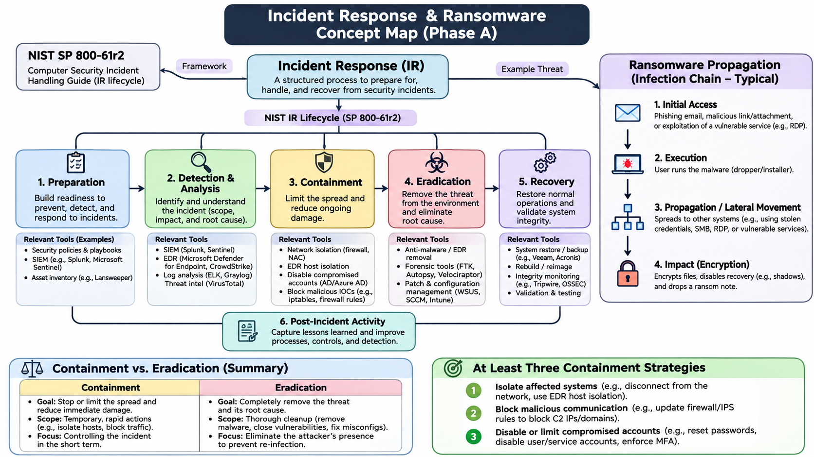
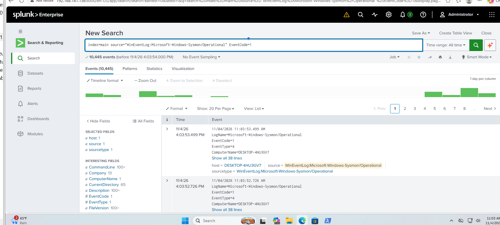
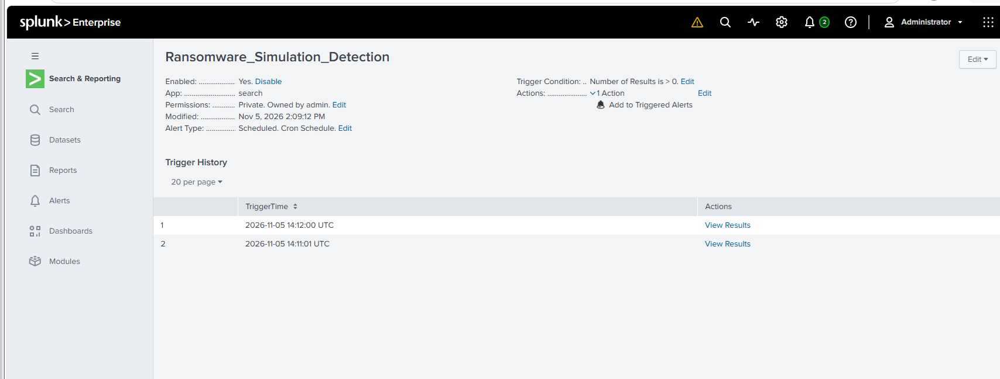
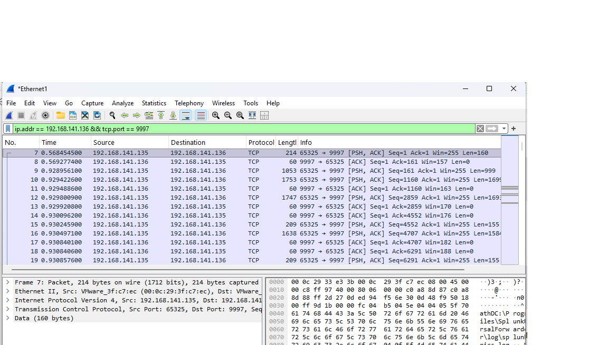
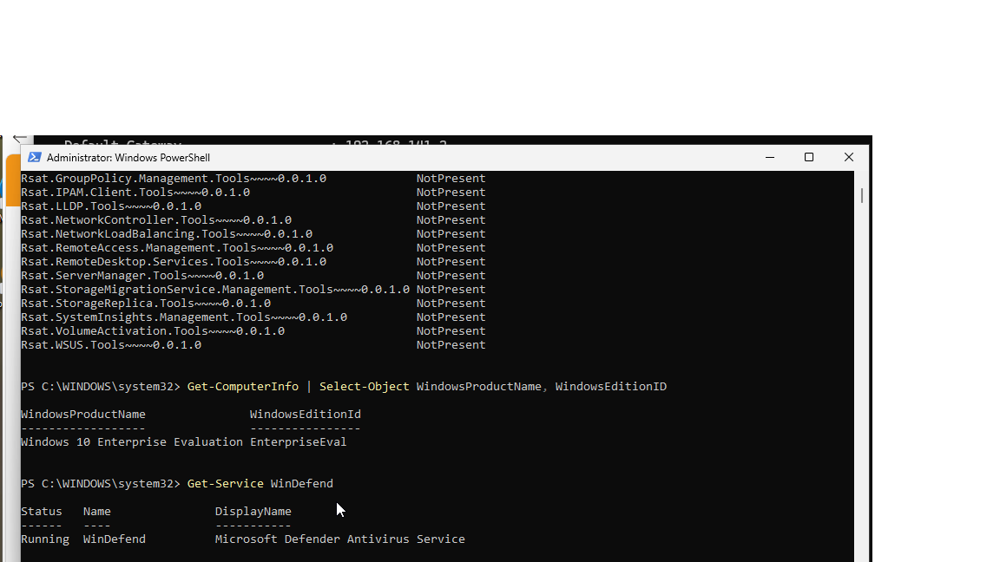

# Incident Response & Ransomware Simulation

## Project Overview

Conducted a controlled ransomware simulation in a virtualized cybersecurity lab to practice incident detection, investigation, containment, and recovery.

The project focused on monitoring suspicious endpoint activity using Splunk and Sysmon, creating security alerts, analyzing network traffic, and restoring an affected system.

## Technologies Used

- Splunk Enterprise
- Windows Sysmon
- Windows 10/11
- Ubuntu Linux
- VMware Workstation
- Wireshark
- PowerShell
- Volatility 3 (memory analysis exploration)

## Project Implementation

### Phase A: Incident Response Planning
- Studied the NIST incident response lifecycle.
- Reviewed preparation, detection, containment, eradication, and recovery procedures.
- Identified important security indicators associated with ransomware activity.

### Phase B: SIEM Deployment
- Installed Splunk on an Ubuntu virtual machine.
- Configured Windows event collection using Winlogbeat.
- Verified Windows endpoint events were visible in Splunk.

### Phase C: Ransomware Detection
- Executed a controlled ransomware simulation in the Windows lab.
- Monitored suspicious activity using Splunk.
- Created an alert to detect simulated encryption-related activity.
- Successfully triggered the security alert.
- Captured network traffic using Wireshark.

### Phase D: Containment & Recovery
- Isolated the affected Windows virtual machine by disabling network connectivity.
- Explored memory analysis using Volatility 3.
- Restored the Windows VM using a previous snapshot.
- Documented recovery evidence.

## Skills Demonstrated

- Security incident detection
- SIEM monitoring and alert configuration
- Windows endpoint investigation
- Incident containment
- Network traffic analysis
- Ransomware response
- Virtual machine recovery
- Incident response documentation

## Project Evidence

### Phase A: Incident Response Planning

### Phase B: Splunk Deployment

### Phase C: Ransomware Detection Alert

### Phase C: Network Traffic Analysis

### Phase D: System Recovery

## Key Takeaways

This project demonstrated the importance of rapid incident detection, accurate alert configuration, network isolation, and reliable recovery procedures during a ransomware incident.

The exercise strengthened my understanding of how security operations and incident response teams investigate and contain endpoint threats.

All activities were performed in an authorized, isolated virtual lab environment.
