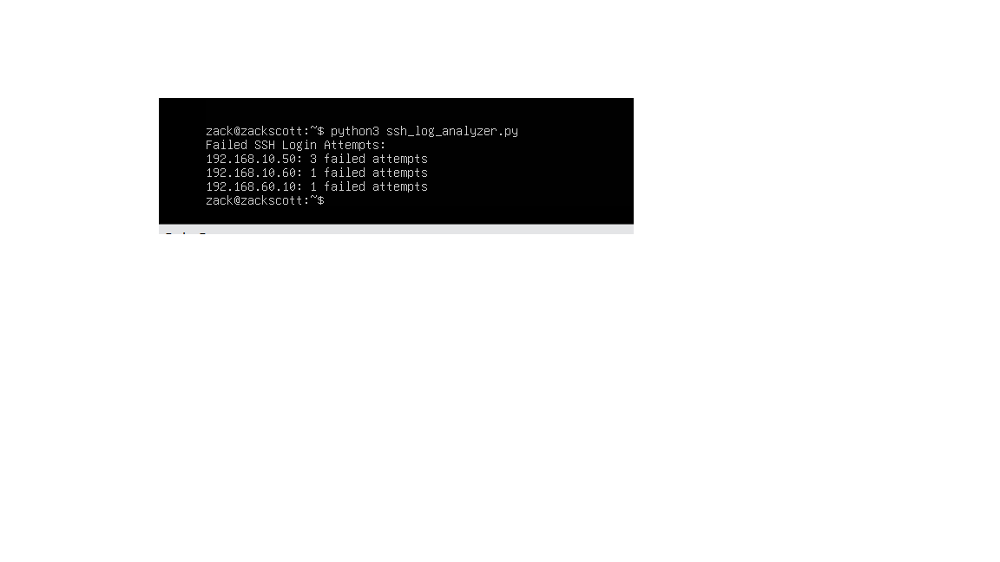
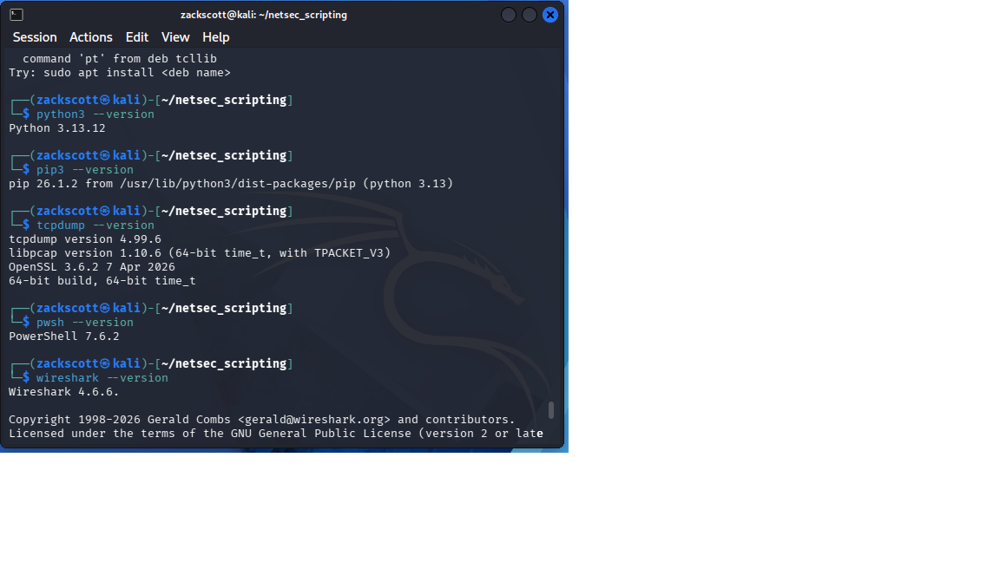
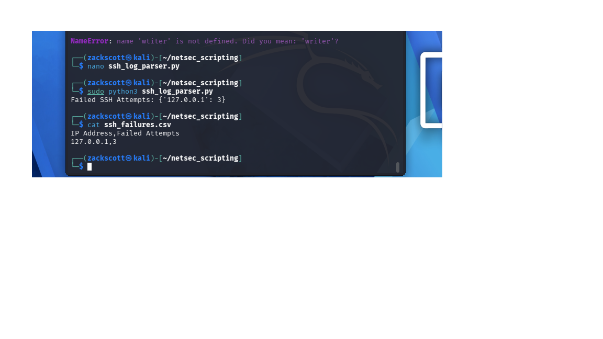
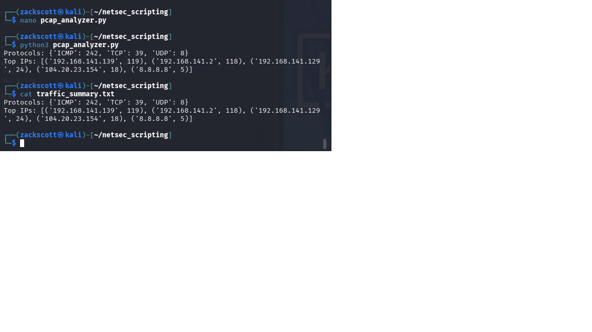

# Security Automation with Python

## Project Overview

Developed and tested Python scripts to automate security log analysis and network traffic monitoring in a controlled cybersecurity lab.

The objective was to reduce manual analysis and generate useful security reports from authentication logs and packet captures.

## Technologies Used

- Python 3
- Scapy
- Kali Linux
- Wireshark
- tcpdump
- SSH
- CSV

## Project 1: SSH Log Parser

**Objective:** Identify failed SSH authentication attempts.

### Implementation
- Developed `ssh_log_parser.py` to analyze SSH authentication logs.
- Extracted source IP addresses associated with failed login attempts.
- Generated `ssh_failures.csv` containing authentication failure results.
- Tested the parser using simulated failed SSH logins.

### Skills Demonstrated
- Python scripting
- Log parsing
- Authentication monitoring
- CSV report generation

## Project 2: Network Packet Analyzer

**Objective:** Automate network traffic analysis.

### Implementation
- Developed `pcap_analyzer.py` using Python and Scapy.
- Captured network traffic using tcpdump.
- Analyzed TCP, UDP, and ICMP packets.
- Identified top communicating IP addresses.
- Exported results to `traffic_summary.txt`.

### Skills Demonstrated
- Network traffic analysis
- Packet inspection
- Python automation
- Security monitoring

## Project Evidence
### Phase A: SSH Log Analysis

### Phase B: Tool Verification

### Phase C: SSH Log Parsing

### Phase D: Network Traffic Analysis

### Python Scripts
- [SSH Log Parser](ssh_log_parser.py)
- [PCAP Analyzer](pcap_analyzer.py)

### Generated Reports
- [SSH Authentication Failures](ssh_failures.csv)
- [Network Traffic Summary](traffic_summary.txt)
## Key Takeaways

This project demonstrated how Python automation can support cybersecurity operations by simplifying repetitive analysis tasks, identifying suspicious authentication activity, and summarizing network traffic.

All testing was conducted in an authorized lab environment.
